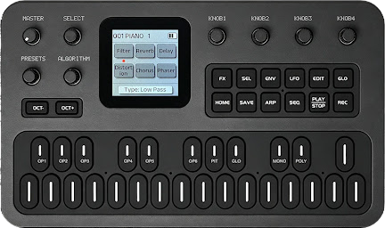

# M-VAVE FM1 Editor & Librarian

A browser-based voice editor and patch librarian for the [M-VAVE FM1](https://www.mvave.com/).

The app runs entirely in the browser. Build and organise your own patch banks, edit every standard DX7 voice parameter and the FM1 effects, and send single patches or whole banks to the FM1 over MIDI. It starts with the FM1's four factory banks, and new banks can come from any of 76 bundled catalog banks or a DX7 `.syx` file.

## What it does

- Keep up to 10 banks of patches in your browser, with search, favourites, drag-and-drop ordering, saved copies, backups, and Undo
- Import and export standard DX7 `.syx` banks and single patches
- Edit every DX7 voice parameter and the FM1's filter, reverb, delay, distortion, chorus, and phaser, with live MIDI updates
- Audition any patch on the FM1 with a click, or from an on-screen keyboard
- Work with Baud Girl's FM-1+VA firmware and M-VAVE's Official Open firmware as well as the stock one
- Use it in British or American English, French, Spanish, German, Brazilian Portuguese, Ukrainian, or Simplified Chinese, in any of the FM1's six colour finishes

See the [full feature list](docs/features.md).

## Requirements

- An M-VAVE FM1, connected to your computer by MIDI
- A browser that supports Web MIDI and SysEx:

  | Browser | Drives the FM1 | Where                             |
  | ------- | -------------- | --------------------------------- |
  | Chrome  | Yes            | Desktop and Android               |
  | Edge    | Yes            | Desktop                           |
  | Firefox | Yes            | Desktop                           |
  | Safari  | No             | Nor any browser on iPhone or iPad |

Web MIDI requires a secure context. The local development server uses HTTPS by default.

## Getting started

1. Open the app in a supported browser. A first visit opens a short welcome; the **Help** button (**?**) opens the full guide at any time.
2. Switch **MIDI online** on and grant MIDI/SysEx permission.
3. Open **Settings** and choose the FM1 as the MIDI output and input.
4. Click a patch to hear it on the FM1, double-click it to edit it, and use **Send to FM1** to transfer a whole bank.

[Getting started](docs/getting-started.md) goes through each step in detail, and the
[user guide](docs/user-guide.md) covers bank management, Favourites, the voice editor, keyboard
shortcuts, and SysEx compatibility.

### Your data

> [!IMPORTANT]
> Imported voices, edits, and FM1 effect settings are saved in this browser and kept after a page reload. Use **Download backup**, under **Backup** in the patch-bank header's **Library actions** menu, to keep a copy, especially before clearing browser data: the backup file holds the banks, their FM1 effects and FM-1+VA preset settings, Favourites, and saved banks, and only this app can restore it. DX7 `.syx` export contains voice data only, for use in other DX7 tools.

If the saved library cannot be opened, the app leaves its browser record untouched and offers **Retry** or **Continue without saving**. The latter creates an explicit session-only library whose changes are lost when the page closes.

## Translations

The librarian is available in multiple languages. If you notice an inaccurate, unclear, or unusual translation, please [get in touch by opening an issue](https://github.com/benny-sparra/fm1-dx7-patch-importer/issues) so it can be corrected.

## Privacy

The deployed site uses cookie-free, aggregate usage analytics and error monitoring. Patch and bank
names, uploaded filenames, MIDI port identities, and SysEx data are never sent. See
[PRIVACY.md](PRIVACY.md) for details.

## Documentation

- [Getting started](docs/getting-started.md): a step-by-step first session
- [Features](docs/features.md): the full feature list
- [User guide](docs/user-guide.md): using the librarian and voice editor, keyboard shortcuts, and
  SysEx compatibility
- [Switching FM1 firmware](docs/switching-firmware.md): moving an FM1 between M-VAVE's firmware,
  FM-1+VA, Felucca, and SLOOP, and recovering from a failed install
- [FM1 firmware](https://fm1-editor.com/firmware/): every firmware known to run on the FM1, with
  links to each project and the week's changes at the top, ordered A–Z, by GitHub stars, or by
  release date, and filtered by kind (source in `firmware/index.html`)
- [Accessibility](ACCESSIBILITY.md): what the app supports, known barriers, and how to report one
- [Privacy](PRIVACY.md): anonymous usage analytics and error monitoring
- [Contributing](CONTRIBUTING.md): local development, quality checks, scripts, and project structure
- [Maintaining](docs/maintaining.md): deployment security, generated assets, source maps, and
  Lighthouse
- [FM1 research notes](docs/fm1-research.md): the evidence behind FM1-specific MIDI behaviour
- [Protocol research and future development](docs/protocol-and-future.md): what the editor sends to
  the FM1, and what might come next

## Acknowledgements

The randomiser is an independent implementation of the voice generator from Tom Bajoras's DX Android, following [the algorithm documented by Christian Zietz (czietz) at CHZ-Soft](https://www.chzsoft.de/site/hardware/dx-android-an-intelligent-random-dx7-voice-generator/dx-android-algorithm/).

The four FM-1 factory banks, loaded into banks A–D on first use and also offered in the catalog, were recovered from M-VAVE's preset-restore tool by KingParamount and are bundled unchanged under CC0 from [fm1-factory-presets](https://github.com/KingParamount/fm1-factory-presets). The licence covers the capture, decode and rebuilt files, not the voices themselves: those trace to Yamaha ROM and VRC cartridges and the community Dexed_cart 1.0 collection, as selected and renamed by M-VAVE. The repository documents the per-voice provenance.

The 26 themed banks in the catalog's **mene311** group are bundled unchanged, with mene311's permission, from [fm1-banks](https://github.com/mene311/fm1-banks). mene311 sorted voices from public DX7 collections, among them Dexed cartridge dumps, Yamaha Black Boxes, and Bobby Blues, into banks of 32 by theme. The voices remain the work of their original programmers, and the repository's `banks/provenance.json` records the collections each one came from.

The 11 banks in the catalog's **Aquanode** group are Dexed presets by Aquanode, released under CC0 and bundled unchanged from [aquanode-soundscapes](https://github.com/aquanodemusic/aquanode-soundscapes). One more bank in that repository, Aquanode Presets 3, is left out because it holds bytes a DX7 bank cannot carry.

[FM-1+VA](https://baudgirl.com/work/FM-1+VA) is Madeline Hoyle's (Baud Girl) replacement firmware for the FM1. Its manual and published web modules informed the research notes; no code was copied from it.

The catalog also draws on the [Yamaha Black Boxes collection](https://yamahablackboxes.com/collection/yamaha-dx7-synthesizer/patches/). The interface links to independent DX7 patch archives to help users find compatible banks. Those downloads are provided by their respective sites; only import files you trust.

If you have programmed a DX7 bank of your own, or gathered other people's voices into banks, you can offer it for the bundled catalog: see [Contributing a patch bank](CONTRIBUTING.md#contributing-a-patch-bank).

## Licence

The editor's source code, documentation, and artwork are released under the [MIT License](LICENSE).
This does not cover third-party material bundled with it, which keeps its own terms:

- **FM1 product images and the M-VAVE logo**: `src/assets/fm1-*.webp`, `src/assets/fm1-header.png`,
  `src/assets/m-vave-logo.png`, `src/assets/m-vave-logo.svg`, their resized copies in
  `src/assets/generated/`, and `public/fm1-preview.png`. These are not the project's own; they stay
  with their owners and are used only to show which device the editor is for. The M-VAVE name and
  logo belong to M-VAVE, and this project is independent: it is not affiliated with or endorsed by
  M-VAVE.
- **Patch banks**: the files in `public/dx7-banks/` keep the terms described under
  [Acknowledgements](#acknowledgements), and banks contributed to the catalog keep the licence their
  author chose.
- **Fonts**: Doto, Space Grotesk, JetBrains Mono, and VT323 are installed from npm under the SIL Open
  Font License 1.1. Departure Mono is under the same licence. DSEG7 Classic (keshikan), which draws
  the editor's numbers, is vendored in `src/fonts/dseg/` under it too.
